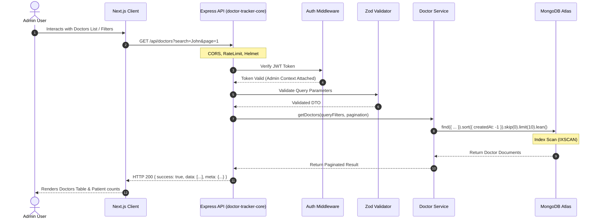
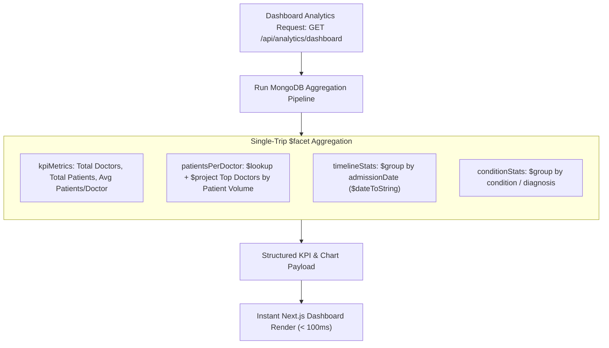
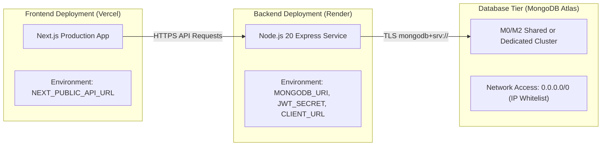

# System Architecture & High-Level Design (HLD)
## Project: Doctor Tracker Distributed Healthcare System

| Document Version | 1.0.0 |
| :--- | :--- |
| **System** | Doctor Tracker Ecosystem |
| **Architectural Style** | Decoupled Client-Server (SPA/SSR Client + Stateless REST API + Managed NoSQL) |

---

## 1. System Topology Overview

The Doctor Tracker platform is organized as a decoupled, multi-tier distributed architecture ensuring strong separation of concerns, independent deployment lifecycles, and horizontal scalability.

```mermaid
flowchart TB
    subgraph ClientTier["Client Tier (Frontend - Next.js)"]
        UI["Next.js App Router (SSR & CSR)"]
        State["Client State & TanStack Query Cache"]
        Charts["Data Visualization Engine (Recharts)"]
        UI --- State
        UI --- Charts
    end

    subgraph EdgeTier["Edge & Gateway Tier"]
        VercelCDN["Vercel Global CDN (Frontend Edge)"]
        RenderGateway["Render Edge / Reverse Proxy (SSL Termination)"]
    end

    subgraph ServiceTier["Backend Tier (doctor-tracker-core)"]
        Express["Node.js / Express Standalone API"]
        AuthMid["Security & JWT Auth Middleware"]
        Router["RESTful API Route Dispatcher"]
        ServiceLayer["Business Logic & Service Layer"]
        Mongoose["Mongoose Data Access Layer (ODM)"]

        Express --> AuthMid --> Router --> ServiceLayer --> Mongoose
    end

    subgraph DataTier["Data Tier"]
        MongoPrimary[("MongoDB Atlas Primary Replica")]
        MongoSecondary[("MongoDB Atlas Secondary Replicas")]
        MongoPrimary -. Replication .-> MongoSecondary
    end

    ClientTier -->|HTTPS / Static Assets| VercelCDN
    ClientTier -->|REST API calls + Bearer Token| RenderGateway
    RenderGateway -->|Internal Proxy| Express
    Mongoose -->|Connection Pool (Mongoose/TLS)| MongoPrimary
```

---

## 2. Component Architecture & Data Flow

### 2.1 Request-Response Lifecycle
1. **User Interaction**: User triggers an action (e.g. searching doctors with a date filter).
2. **Client Validation & Query Construction**: The Next.js client encodes search parameters (`/api/doctors?search=cardio&startDate=2026-01-01&page=1&limit=10`) and dispatches an authenticated HTTP GET request.
3. **Security Perimeter**:
   - **CORS Filter**: Validates `Origin` header against permitted frontend domains.
   - **Rate Limiter**: Tracks request token buckets per client IP.
   - **Helmet**: Enforces secure HTTP response headers (CSP, HSTS, X-Frame-Options).
4. **Authentication Middleware**: Verifies the JWT signature, decodes admin claims, and verifies active status.
5. **Request Validation**: Zod schema validates and parses query parameters and request bodies, stripping unexpected fields.
6. **Controller Dispatch**: Unpacks validated parameters and invokes the corresponding Service method.
7. **Service Layer Execution**: Executes business rules, builds optimized MongoDB query criteria, or triggers an aggregation pipeline.
8. **Mongoose / MongoDB Data Access**:
   - Executes query against MongoDB utilizing compound and text indexes (`IXSCAN`).
   - Retrieves lean document payloads.
9. **Standardized Response Packaging**: Wraps data in `{ success: true, data: [...], meta: { ... } }` and returns HTTP 200 OK.



---

## 3. High-Level Security Architecture

```mermaid
flowchart LR
    subgraph Client["Client Browser"]
        Storage["Memory / Secure Cookie"]
    end

    subgraph APIPerimeter["API Perimeter Security"]
        Rate["Rate Limiting (100 req/15min)"]
        Sanitize["NoSQL Injection Sanitizer"]
        CORS["CORS Allow-List"]
    end

    subgraph AuthLayer["Authentication & Authorization"]
        JWTVerify["JWT Signature Verification (HS256)"]
        RoleCheck["Admin Role Verification"]
    end

    subgraph DataProtection["Data Layer Protection"]
        Bcrypt["Bcrypt Password Hashing (Cost: 10)"]
        SchemaVal["Mongoose Strict Schema Enforcement"]
    end

    Storage -->|Bearer Token| Rate
    Rate --> Sanitize
    Sanitize --> CORS
    CORS --> JWTVerify
    JWTVerify --> RoleCheck
    RoleCheck --> SchemaVal
    SchemaVal --> Bcrypt
```



### 3.1 Security Principles
- **Defense in Depth**: Security applied at network boundary, application middleware, business layer, and database constraints.
- **Principle of Least Privilege**: API only exposes required attributes. Sensitive fields like `password` are excluded by default via schema projection (`select: false`).
- **NoSQL Injection Defense**: Dynamic queries strictly construct filter objects using typed, whitelisted primitives rather than passing raw `req.query` objects into Mongoose find methods.

---

## 4. Analytical Aggregation Architecture

To fulfill the dashboard requirements with maximum performance, analytics are computed server-side via **MongoDB Aggregation Pipelines** using a single-trip `$facet` pipeline:



---

## 5. Deployment Topology


