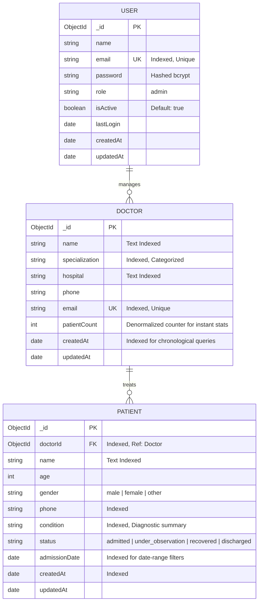

# Database Design & Query Optimization Specification
## Project: Doctor Tracker Core

| Document Version | 1.0.0 |
| :--- | :--- |
| **Engine** | MongoDB (v6.0+) |
| **Object Data Modeling (ODM)** | Mongoose (v8.x) |
| **Performance Benchmark** | Zero Full Table Scans (`COLLSCAN`) on query pathways |

---

## 1. Entity-Relationship Diagram (ERD)



---

## 2. Collection Schemas & Data Dictionaries

### 2.1 Collection: `users`
Stores administrative identities authorized to manage doctors, patients, and view analytics.

| Field | Type | Required | Unique | Indexed | Description / Validation |
| :--- | :--- | :---: | :---: | :---: | :--- |
| `_id` | `ObjectId` | Yes | Yes | Yes (PK) | Auto-generated document identifier |
| `name` | `String` | Yes | No | No | Trimmed, 2–100 characters |
| `email` | `String` | Yes | Yes | Yes | Lowercase, valid RFC 5322 email regex |
| `password` | `String` | Yes | No | No | Hashed bcrypt string (`select: false`) |
| `role` | `String` | Yes | No | No | Enum: `['admin', 'superadmin']`, default: `admin` |
| `isActive` | `Boolean` | Yes | No | No | Default: `true` |
| `lastLogin` | `Date` | No | No | No | Timestamp of most recent authentication |
| `createdAt` | `Date` | Yes | No | Yes | Automatic Mongoose timestamp |
| `updatedAt` | `Date` | Yes | No | No | Automatic Mongoose timestamp |

### 2.2 Collection: `doctors`
Stores doctor profiles and credentials.

| Field | Type | Required | Unique | Indexed | Description / Validation |
| :--- | :--- | :---: | :---: | :---: | :--- |
| `_id` | `ObjectId` | Yes | Yes | Yes (PK) | Auto-generated document identifier |
| `name` | `String` | Yes | No | Yes (Text) | Trimmed, 2–100 characters |
| `specialization` | `String` | Yes | No | Yes | E.g. Cardiology, Neurology, Pediatrics |
| `hospital` | `String` | Yes | No | Yes (Text) | Affiliated healthcare institution |
| `phone` | `String` | Yes | No | No | Standardized phone format |
| `email` | `String` | Yes | Yes | Yes | Lowercase unique email address |
| `patientCount` | `Number` | Yes | No | No | Cached active patient count (default: 0) |
| `createdAt` | `Date` | Yes | No | Yes | Chronological sorting index |
| `updatedAt` | `Date` | Yes | No | No | Automatic Mongoose timestamp |

### 2.3 Collection: `patients`
Stores registered patients and binds them to their designated attending physician.

| Field | Type | Required | Unique | Indexed | Description / Validation |
| :--- | :--- | :---: | :---: | :---: | :--- |
| `_id` | `ObjectId` | Yes | Yes | Yes (PK) | Auto-generated document identifier |
| `doctorId` | `ObjectId` | Yes | No | Yes | Foreign Key referencing `Doctor._id` |
| `name` | `String` | Yes | No | Yes (Text) | Patient full legal name |
| `age` | `Number` | Yes | No | No | Positive integer (0–130) |
| `gender` | `String` | Yes | No | No | Enum: `['male', 'female', 'other']` |
| `phone` | `String` | Yes | No | Yes | Contact phone number |
| `condition` | `String` | Yes | No | Yes | Clinical condition / diagnostic chief complaint |
| `status` | `String` | Yes | No | Yes | Enum: `['admitted', 'under_observation', 'recovered', 'discharged']` |
| `admissionDate` | `Date` | Yes | No | Yes | Date of admission or registration |
| `createdAt` | `Date` | Yes | No | Yes | Timestamp |
| `updatedAt` | `Date` | Yes | No | No | Timestamp |

---

## 3. MongoDB Indexing Strategy

Indexing is purposefully constructed to guarantee $O(\log N)$ b-tree lookup speeds, completely avoiding collection scans (`COLLSCAN`).

### 3.1 `doctors` Collection Indexes
```javascript
// 1. Unique email index
db.doctors.createIndex({ email: 1 }, { unique: true, name: "idx_doctors_email_unique" });

// 2. Compound index for filtered and sorted doctor lists
db.doctors.createIndex({ specialization: 1, createdAt: -1 }, { name: "idx_doctors_spec_created" });

// 3. Date-based filtering index
db.doctors.createIndex({ createdAt: -1 }, { name: "idx_doctors_createdAt_desc" });

// 4. Text index for rapid keyword search
db.doctors.createIndex(
  { name: "text", specialization: "text", hospital: "text" },
  { weights: { name: 5, specialization: 3, hospital: 2 }, name: "idx_doctors_text_search" }
);
```

### 3.2 `patients` Collection Indexes
```javascript
// 1. Foreign key reference index for fast doctor-patient lookups
db.patients.createIndex({ doctorId: 1, createdAt: -1 }, { name: "idx_patients_doctorId_created" });

// 2. Status & Admission Date compound index for patient status filtering
db.patients.createIndex({ status: 1, admissionDate: -1 }, { name: "idx_patients_status_admission" });

// 3. Condition & Date compound index
db.patients.createIndex({ condition: 1, admissionDate: -1 }, { name: "idx_patients_condition_date" });

// 4. Text index for patient search
db.patients.createIndex(
  { name: "text", phone: "text", condition: "text" },
  { weights: { name: 5, condition: 3, phone: 2 }, name: "idx_patients_text_search" }
);
```

---

## 4. Aggregation Pipeline Specifications

### 4.1 Dashboard Multi-Metric Facet Pipeline
This single-trip aggregation calculates:
1. Total doctors and total patients
2. Average patients per doctor
3. Top doctors by patient volume
4. Admission timeline over time
5. Patient breakdown by diagnosis condition

```javascript
const dashboardAggregationPipeline = [
  {
    $facet: {
      kpiTotals: [
        {
          $group: {
            _id: null,
            totalPatients: { $sum: 1 },
            admittedPatients: {
              $sum: { $cond: [{ $eq: ["$status", "admitted"] }, 1, 0] }
            },
            recoveredPatients: {
              $sum: { $cond: [{ $eq: ["$status", "recovered"] }, 1, 0] }
            },
            dischargedPatients: {
              $sum: { $cond: [{ $eq: ["$status", "discharged"] }, 1, 0] }
            }
          }
        }
      ],
      patientsPerDoctor: [
        {
          $group: {
            _id: "$doctorId",
            patientCount: { $sum: 1 }
          }
        },
        {
          $lookup: {
            from: "doctors",
            localField: "_id",
            foreignField: "_id",
            as: "doctor"
          }
        },
        { $unwind: "$doctor" },
        {
          $project: {
            _id: 1,
            doctorName: "$doctor.name",
            specialization: "$doctor.specialization",
            patientCount: 1
          }
        },
        { $sort: { patientCount: -1 } },
        { $limit: 10 }
      ],
      admissionTimeline: [
        {
          $group: {
            _id: { $dateToString: { format: "%Y-%m-%d", date: "$admissionDate" } },
            admissions: { $sum: 1 }
          }
        },
        { $sort: { _id: 1 } },
        { $limit: 30 }
      ],
      conditionBreakdown: [
        {
          $group: {
            _id: "$condition",
            count: { $sum: 1 }
          }
        },
        { $sort: { count: -1 } },
        { $limit: 10 }
      ]
    }
  }
];
```

---

## 5. Query Optimization & Performance Best Practices

1. **Avoid In-Memory Sorts**:
   - Every `.sort()` field is covered by an index prefix (`createdAt: -1` or `admissionDate: -1`), ensuring sorts leverage index order directly.
2. **Projection Minimization**:
   - Only required fields are selected from queries, reducing network bandwidth between MongoDB Atlas and the Express API server.
3. **Mongoose Lean Mode**:
   - Read-heavy queries execute with `.lean()`, returning plain JavaScript objects rather than heavy Mongoose document wrappers.
4. **Denormalized Counters & Atomicity**:
   - When patients are added or removed under a doctor, Mongoose hooks or service logic execute atomic `$inc: { patientCount: 1 }` or `$inc: { patientCount: -1 }` on the Doctor document, allowing instant O(1) reads for doctor patient capacity.
