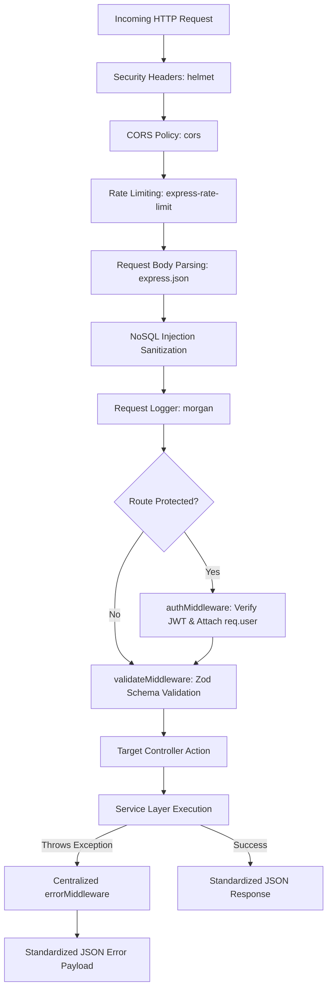

# Low-Level Design (LLD)
## Project: Doctor Tracker Core

| Document Version | 1.0.0 |
| :--- | :--- |
| **System** | `doctor-tracker-core` REST Service |
| **Architectural Pattern** | Controller-Service-Model / Clean Layered Architecture |
| **Type Safety** | Strict TypeScript + Zod Runtime Inferred Types |

---

## 1. Class & Module Architecture

```mermaid
classDiagram
    class AuthController {
        +login(req: Request, res: Response, next: NextFunction)
        +logout(req: Request, res: Response, next: NextFunction)
        +getMe(req: Request, res: Response, next: NextFunction)
    }

    class AuthService {
        +authenticateUser(credentials: LoginDTO): Promise~AuthResult~
        +generateToken(payload: TokenPayload): string
        +verifyToken(token: string): TokenPayload
    }

    class DoctorController {
        +createDoctor(req: Request, res: Response, next: NextFunction)
        +getDoctors(req: Request, res: Response, next: NextFunction)
        +getDoctorById(req: Request, res: Response, next: NextFunction)
        +updateDoctor(req: Request, res: Response, next: NextFunction)
        +deleteDoctor(req: Request, res: Response, next: NextFunction)
        +getDoctorPatients(req: Request, res: Response, next: NextFunction)
        +addPatientToDoctor(req: Request, res: Response, next: NextFunction)
        +removePatientFromDoctor(req: Request, res: Response, next: NextFunction)
    }

    class DoctorService {
        +create(dto: CreateDoctorDTO): Promise~IDoctor~
        +findAll(filters: DoctorQueryFilter, pagination: PaginationOptions): Promise~PaginatedResult~
        +findById(id: string): Promise~IDoctor~
        +update(id: string, dto: UpdateDoctorDTO): Promise~IDoctor~
        +delete(id: string): Promise~void~
        +getPatients(doctorId: string, pagination: PaginationOptions): Promise~PaginatedResult~
        +addPatient(doctorId: string, dto: CreatePatientDTO): Promise~IPatient~
        +removePatient(doctorId: string, patientId: string): Promise~void~
    }

    class PatientController {
        +getPatients(req: Request, res: Response, next: NextFunction)
        +getPatientById(req: Request, res: Response, next: NextFunction)
        +updatePatient(req: Request, res: Response, next: NextFunction)
        +deletePatient(req: Request, res: Response, next: NextFunction)
    }

    class PatientService {
        +findAll(filters: PatientQueryFilter, pagination: PaginationOptions): Promise~PaginatedResult~
        +findById(id: string): Promise~IPatient~
        +update(id: string, dto: UpdatePatientDTO): Promise~IPatient~
        +delete(id: string): Promise~void~
    }

    class AnalyticsController {
        +getDashboardAnalytics(req: Request, res: Response, next: NextFunction)
    }

    class AnalyticsService {
        +getDashboardMetrics(): Promise~DashboardMetricsDTO~
    }

    AuthController --> AuthService
    DoctorController --> DoctorService
    PatientController --> PatientService
    AnalyticsController --> AnalyticsService
```



---

## 2. Middleware Execution Pipeline

Every HTTP request traverses an ordered pipeline before arriving at the controller:



---

## 3. Data Transfer Objects (DTO) & Zod Validation Schemas

### 3.1 Authentication Schemas
```typescript
import { z } from "zod";

export const LoginSchema = z.object({
  body: z.object({
    email: z.string().trim().email("Please enter a valid email address"),
    password: z.string().min(6, "Password must be at least 6 characters")
  })
});
export type LoginDTO = z.infer<typeof LoginSchema>["body"];
```

### 3.2 Doctor Schemas
```typescript
export const CreateDoctorSchema = z.object({
  body: z.object({
    name: z.string().trim().min(2, "Name must be at least 2 characters").max(100),
    specialization: z.string().trim().min(2, "Specialization is required"),
    hospital: z.string().trim().min(2, "Hospital name is required"),
    phone: z.string().trim().min(8, "Valid phone number is required"),
    email: z.string().trim().email("Valid email address is required")
  })
});

export const DoctorQuerySchema = z.object({
  query: z.object({
    search: z.string().optional(),
    specialization: z.string().optional(),
    startDate: z.string().datetime({ offset: true }).optional().or(z.string().regex(/^\d{4}-\d{2}-\d{2}$/).optional()),
    endDate: z.string().datetime({ offset: true }).optional().or(z.string().regex(/^\d{4}-\d{2}-\d{2}$/).optional()),
    page: z.coerce.number().int().positive().default(1),
    limit: z.coerce.number().int().positive().max(100).default(10),
    sortBy: z.enum(["name", "createdAt", "patientCount"]).default("createdAt"),
    sortOrder: z.enum(["asc", "desc"]).default("desc")
  })
});
```

### 3.3 Patient Schemas
```typescript
export const PatientStatusEnum = z.enum(["admitted", "under_observation", "recovered", "discharged"]);
export const GenderEnum = z.enum(["male", "female", "other"]);

export const CreatePatientSchema = z.object({
  body: z.object({
    name: z.string().trim().min(2, "Patient name is required"),
    age: z.coerce.number().int().min(0).max(130, "Invalid age"),
    gender: GenderEnum,
    phone: z.string().trim().min(8, "Phone number is required"),
    condition: z.string().trim().min(2, "Diagnostic condition is required"),
    status: PatientStatusEnum.default("admitted"),
    doctorId: z.string().regex(/^[0-9a-fA-F]{24}$/, "Invalid Doctor ID"),
    admissionDate: z.coerce.date().default(() => new Date())
  })
});

export const PatientQuerySchema = z.object({
  query: z.object({
    search: z.string().optional(),
    doctorId: z.string().regex(/^[0-9a-fA-F]{24}$/).optional(),
    status: PatientStatusEnum.optional(),
    condition: z.string().optional(),
    startDate: z.string().optional(),
    endDate: z.string().optional(),
    page: z.coerce.number().int().positive().default(1),
    limit: z.coerce.number().int().positive().max(100).default(10),
    sortBy: z.enum(["name", "admissionDate", "createdAt", "age"]).default("admissionDate"),
    sortOrder: z.enum(["asc", "desc"]).default("desc")
  })
});
```

---

## 4. Centralized Error Handling Architecture

### 4.1 Custom Application Error (`AppError.ts`)
```typescript
export class AppError extends Error {
  public readonly statusCode: number;
  public readonly isOperational: boolean;
  public readonly details?: any;

  constructor(message: string, statusCode = 500, details?: any) {
    super(message);
    this.statusCode = statusCode;
    this.isOperational = true;
    this.details = details;
    Error.captureStackTrace(this, this.constructor);
  }

  static badRequest(msg: string, details?: any) {
    return new AppError(msg, 400, details);
  }
  static unauthorized(msg = "Unauthorized access") {
    return new AppError(msg, 401);
  }
  static forbidden(msg = "Forbidden request") {
    return new AppError(msg, 403);
  }
  static notFound(msg = "Resource not found") {
    return new AppError(msg, 404);
  }
  static conflict(msg: string) {
    return new AppError(msg, 409);
  }
}
```

### 4.2 Standardized Response Payloads
All responses maintain a uniform structure:

**Success Response (HTTP 200/201):**
```json
{
  "success": true,
  "statusCode": 200,
  "data": { ... },
  "meta": {
    "page": 1,
    "limit": 10,
    "total": 45,
    "totalPages": 5
  }
}
```

**Error Response (HTTP 4xx/5xx):**
```json
{
  "success": false,
  "statusCode": 400,
  "error": {
    "message": "Validation failed",
    "details": [
      {
        "field": "email",
        "message": "Valid email address is required"
      }
    ]
  }
}
```

---

## 5. Query Builder & Pagination Utility

```typescript
export interface PaginationResult<T> {
  data: T[];
  meta: {
    page: number;
    limit: number;
    total: number;
    totalPages: number;
    hasNextPage: boolean;
    hasPrevPage: boolean;
  };
}

export async function paginateQuery<T>(
  query: any,
  page: number,
  limit: number,
  countQuery?: any
): Promise<PaginationResult<T>> {
  const skip = (page - 1) * limit;
  const [data, total] = await Promise.all([
    query.skip(skip).limit(limit).lean(),
    countQuery ? countQuery.countDocuments() : 0
  ]);
  const totalPages = Math.ceil(total / limit);

  return {
    data,
    meta: {
      page,
      limit,
      total,
      totalPages,
      hasNextPage: page < totalPages,
      hasPrevPage: page > 1
    }
  };
}
```
