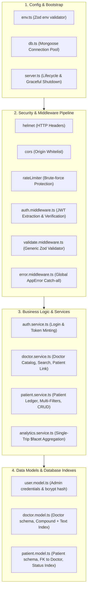
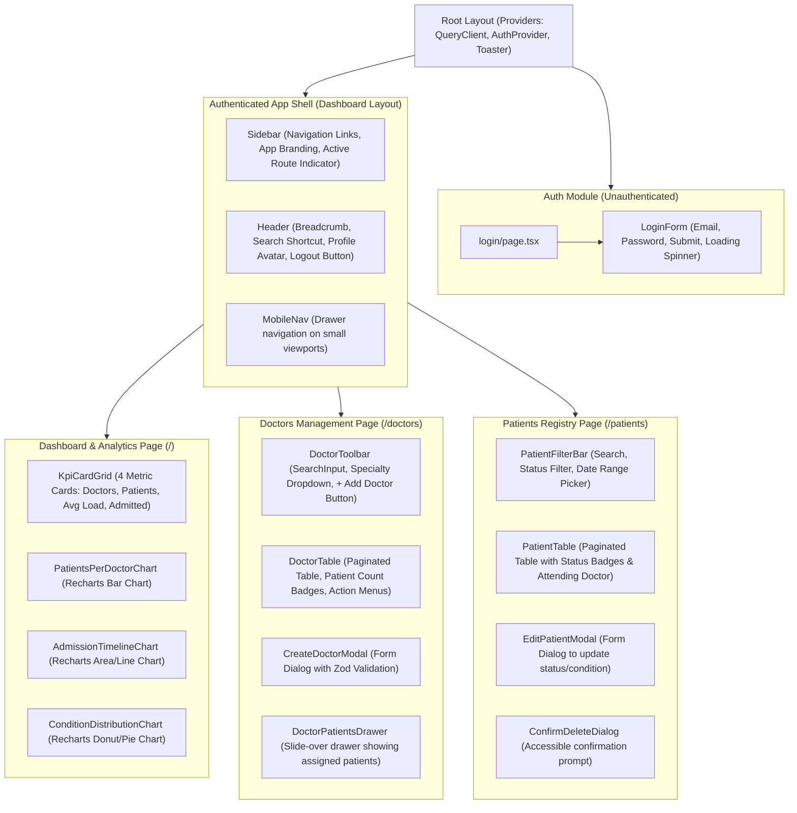

# Packages & Components Architectural Blueprint
## Project: Doctor Tracker Ecosystem (Backend & Frontend)

| Document Version | 1.0.0 |
| :--- | :--- |
| **System** | Doctor Tracker Ecosystem |
| **Backend Service** | `doctor-tracker-core` (Node.js + Express + TypeScript) |
| **Frontend Application** | `doctor-tracker-client` (Next.js 14/15 App Router + React + Tailwind CSS) |

---

## 1. Backend (`doctor-tracker-core`): Dependencies & Packages

### 1.1 Production Dependencies (`dependencies`)

| Package | Version | Purpose & Rationale |
| :--- | :--- | :--- |
| `express` | `^4.19.2` | High-performance, lightweight HTTP server framework powering the standalone RESTful API. |
| `mongoose` | `^8.7.2` | MongoDB ODM providing schema enforcement, compound/text indexing, hooks, and native `$facet` aggregation pipelines. |
| `dotenv` | `^16.4.5` | Loads environment configurations from `.env` files into `process.env`. |
| `zod` | `^3.23.8` | Schema declaration and data validation library for request payloads, query parameters, and environment validation. |
| `jsonwebtoken` | `^9.0.2` | Generates and verifies HMAC SHA-256 signed JSON Web Tokens for stateless authentication. |
| `bcryptjs` | `^2.4.3` | Pure JavaScript implementation of bcrypt password hashing algorithm with zero native C++ binding issues. |
| `cors` | `^2.8.5` | Configures Cross-Origin Resource Sharing headers to secure frontend-backend communication. |
| `helmet` | `^7.1.0` | Sets critical HTTP security headers (CSP, HSTS, X-Content-Type-Options) to safeguard against common web vulnerabilities. |
| `express-rate-limit` | `^7.4.1` | Protects endpoints against brute-force password guessing and denial-of-service (DoS) traffic spikes. |
| `morgan` | `^1.10.0` | HTTP request logging middleware for developer visibility and request tracing. |

### 1.2 Development Dependencies (`devDependencies`)

| Package | Version | Purpose & Rationale |
| :--- | :--- | :--- |
| `typescript` | `^5.6.3` | Static type checker ensuring end-to-end type safety and contract enforcement. |
| `tsx` | `^4.19.1` | Ultra-fast TypeScript execution engine powered by esbuild for local development without manual compile steps. |
| `@types/express` | `^4.17.21` | Type definitions for Express.js. |
| `@types/node` | `^20.17.0` | Type definitions for Node.js runtime APIs. |
| `@types/cors` | `^2.8.17` | Type definitions for CORS middleware. |
| `@types/jsonwebtoken` | `^9.0.7` | Type definitions for JWT. |
| `@types/bcryptjs` | `^2.4.6` | Type definitions for bcryptjs. |
| `@types/morgan` | `^1.9.9` | Type definitions for Morgan HTTP logger. |
| `rimraf` | `^6.0.1` | Cross-platform build directory cleaner (`rimraf dist`). |

---

## 2. Frontend (`doctor-tracker-client`): Dependencies & Packages

### 2.1 Production Dependencies (`dependencies`)

| Package | Version | Purpose & Rationale |
| :--- | :--- | :--- |
| `next` | `^14.2.15` / `^15.0.0` | Production React framework offering App Router, server-side rendering, streaming, and asset optimization. |
| `react` & `react-dom` | `^18.3.1` / `^19.0.0` | Core declarative UI rendering library. |
| `recharts` | `^2.13.0` | Composable charting library built on React components for rendering responsive Bar, Area, and Donut charts. |
| `@tanstack/react-query` | `^5.59.16` | Declarative asynchronous server-state management, automated query caching, refetching, and pagination handling. |
| `axios` | `^1.7.7` | Promise-based HTTP client with request/response interceptors for Bearer token management and automatic 401 handling. |
| `lucide-react` | `^0.453.0` | Clean, modern, accessible icon library for consistent healthcare UI iconography. |
| `clsx` & `tailwind-merge` | Latest | Utility functions for conditionally merging Tailwind CSS classes without stylesheet conflicts (`cn()` helper). |
| `class-variance-authority`| `^0.7.0` | Type-safe component variant styling tool (e.g. Button variants, Badge color states). |
| `@radix-ui/react-dialog` | `^1.1.2` | Unstyled, accessible modal primitives for Create/Edit Doctor and Patient dialogs. |
| `@radix-ui/react-dropdown-menu` | `^2.1.2` | Accessible dropdown menus for table row action menus. |
| `@radix-ui/react-select` | `^2.1.2` | Accessible custom select dropdown for status, specialization, and doctor selection. |
| `date-fns` | `^4.1.0` | Modern, modular JavaScript date utility library for formatting and calculating date ranges. |
| `sonner` | `^1.5.0` | Modern, beautiful, non-intrusive toast notification component for user feedback. |

### 2.2 Development Dependencies (`devDependencies`)

| Package | Version | Purpose & Rationale |
| :--- | :--- | :--- |
| `tailwindcss` | `^3.4.14` | Utility-first CSS framework for custom responsive design tokens. |
| `postcss` & `autoprefixer` | Latest | CSS post-processing pipeline for browser vendor prefixes. |
| `typescript` | `^5.6.3` | Static type checker. |
| `@types/react` | `^18.3.11` | React type definitions. |
| `@types/node` | `^20.17.0` | Node.js type definitions. |

---

## 3. Backend Component Architecture (`doctor-tracker-core`)

The backend is composed of modular, decoupled components designed to operate independently and testably:

### 3.1 Backend Component Responsibilities
1. **`auth.service`**: Validates administrator email and password with `bcryptjs.compare`, generates signed JWTs, and exposes identity claims.
2. **`doctor.service`**:
   - Manages doctor onboarding with unique email validation.
   - Executes paginated queries using `.skip()` and `.limit()` on indexed fields.
   - Handles doctor-patient associations: fetches assigned patients, directly creates a patient under a doctor, and unlinks patients with atomic `$inc: { patientCount: 1 / -1 }`.
3. **`patient.service`**:
   - Manages patient lifecycle (create, update diagnostic condition, delete).
   - Executes multi-filtering combining status, date ranges, and regex search across name and phone.
4. **`analytics.service`**:
   - Executes a single-trip MongoDB aggregation pipeline with `$facet`:
     - Computes KPI totals (doctors, patients, average load).
     - Groups patients per doctor and unwinds doctor details.
     - Buckets patient admissions across date intervals.
     - Summarizes disease/condition distributions.
5. **`seeder.service`**:
   - Drops development collections and seeds realistic doctors, patients, and admin credentials for immediate local and live evaluation.

---

## 4. Frontend Component Hierarchy (`doctor-tracker-client`)

The frontend component tree is organized into reusable design primitives, structural layouts, and domain feature modules:

### 4.2 Reusable Shared Components
1. **`SearchInput`**: Text input with built-in search icon, clear button, and 300ms debounce hook.
2. **`DateRangePicker`**: Accessible date-range selector with predefined intervals (Today, Last 7 Days, Last 30 Days, Custom Range).
3. **`PaginationControls`**: Displays current page index, total records, page size selector (10, 25, 50), and responsive Next/Prev buttons.
4. **`StatusBadge`**: Visual colored badge representing clinical states:
   - `admitted` -> Amber / Warning badge
   - `under_observation` -> Blue / Info badge
   - `recovered` -> Green / Success badge
   - `discharged` -> Slate / Neutral badge
5. **`ConfirmDialog`**: Reusable destructive action confirmation modal preventing accidental deletions.
6. **`EmptyState`**: Visually appealing empty state illustration with contextual action button when no records match filter criteria.

---

## 5. Summary of Key Architectural Choices

1. **Standalone Express Backend (`doctor-tracker-core`)**:
   - Zero framework locking; deploys smoothly to Render, Railway, or VPS.
   - Clear separation between REST endpoints and client rendering.
2. **MongoDB Native Aggregations**:
   - Avoids calculating statistics in Node.js memory. All analytics happen directly on the database engine.
3. **TanStack React Query on Frontend**:
   - Provides instant query caching, automatic background refetching, and declarative pagination without manual `useEffect` bugs.
4. **Radix UI Primitives + Tailwind CSS**:
   - Delivers accessibility (WAI-ARIA compliant), keyboard navigation, and full styling flexibility without heavy monolithic CSS libraries.
