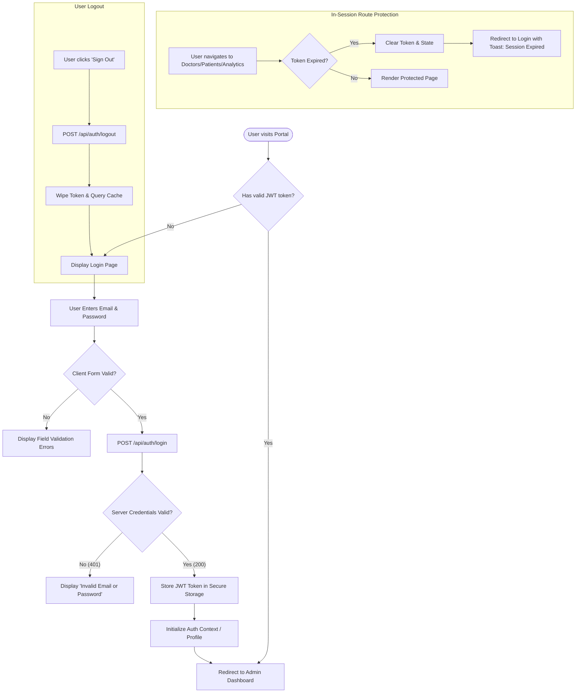
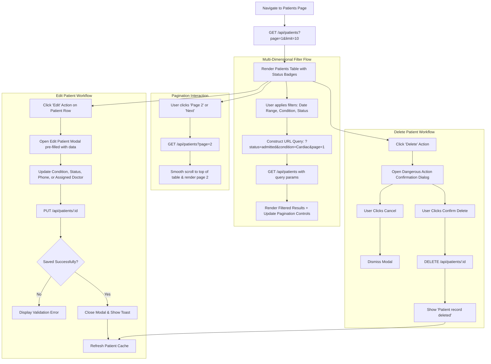
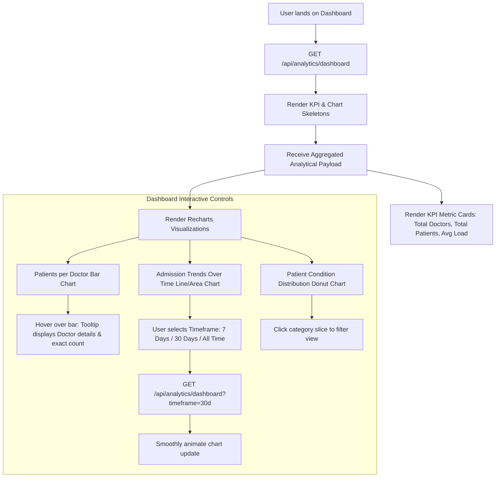

# User Flows & Interaction State Diagrams
## Project: Doctor Tracker Portal

| Document Version | 1.0.0 |
| :--- | :--- |
| **System** | Doctor Tracker Web Portal |
| **Target Roles** | Healthcare Administrator, Desk Coordinator |

---

## 1. Authentication & Session Management Flow

This flow illustrates the user authentication lifecycle, token retention, automated route protection, and session revocation.



---

## 2. Doctor Management User Flow

Covers creating a doctor, searching/filtering the directory, viewing doctor profile details, and viewing associated patients.

```mermaid
flowchart TD
    NavDoctors[Navigate to Doctors Directory] --> FetchDoctors[GET /api/doctors with page=1]
    FetchDoctors --> DisplayCatalog[Render Doctors Grid/Table]

    subgraph SearchAndFilter["Search & Filter Interactions"]
        DisplayCatalog --> InputSearch[Type in Search Bar: 'Cardio']
        InputSearch --> Debounce[Debounce 300ms]
        Debounce --> TriggerSearch[GET /api/doctors?search=Cardio]
        TriggerSearch --> UpdateTable[Update Doctors Table]

        DisplayCatalog --> SelectSpec[Select Specialty / Date Filter]
        SelectSpec --> TriggerFilter[GET /api/doctors?specialization=...&startDate=...]
        TriggerFilter --> UpdateTable
    end

    subgraph CreateDoctor["Create New Doctor"]
        DisplayCatalog --> ClickAddDoc[Click '+ Add Doctor' Button]
        ClickAddDoc --> OpenDocModal[Open Create Doctor Modal]
        OpenDocModal --> FillDocForm[Input Name, Specialization, Hospital, Phone, Email]
        FillDocForm --> SubmitDoc[Click 'Save Doctor']
        SubmitDoc --> PostDoc[POST /api/doctors]
        PostDoc --> DocSuccess{Created Successfully?}
        DocSuccess -- No (400/409) --> ShowDocErr[Display Error Notification / Duplicate Email]
        DocSuccess -- Yes (201) --> CloseDocModal[Close Modal & Show Success Toast]
        CloseDocModal --> RefreshDoctors[Invalidate Query Cache & Refresh List]
    end

    subgraph ViewDetailsAndPatients["View Doctor & Assigned Patients"]
        DisplayCatalog --> ClickRow[Click on Doctor Card/Row]
        ClickRow --> OpenDrawer[Open Doctor Detail View / Drawer]
        OpenDrawer --> FetchAssigned[GET /api/doctors/:id/patients]
        FetchAssigned --> ShowPatientsTab[Render Assigned Patients List]
        
        ShowPatientsTab --> ClickAddPatient[Click '+ Assign New Patient']
        ClickAddPatient --> OpenAddPatientModal[Open Patient Enrollment Form (Doctor Pre-selected)]
        OpenAddPatientModal --> SubmitAssignedPatient[POST /api/doctors/:id/patients]
        SubmitAssignedPatient --> RefreshAssigned[Update Doctor's Patient Count & List]

        ShowPatientsTab --> ClickRemovePatient[Click 'Remove' on Patient]
        ClickRemovePatient --> ConfirmModal[Show Confirmation Prompt]
        ConfirmModal --> ConfirmYes[DELETE /api/doctors/:id/patients/:patientId]
        ConfirmYes --> RefreshAssigned
    end
```

---

## 3. Dedicated Patient Management User Flow

Covers the central Patient Registry, advanced filtering (date, condition, status), pagination, and patient editing/deletion.



---

## 4. Analytics & Dashboard User Flow

Covers the executive dashboard, KPI cards, visual charts, and filtering timeframes.



---

## 5. Edge Cases & Error Recovery Flows

| Scenario | System Behavior | User Feedback |
| :--- | :--- | :--- |
| **Network Disconnection** | API client catches timeout/failure | Toast: *"Unable to reach server. Please check your internet connection."* Action: Retry button. |
| **Token Expiration (401)** | Interceptor detects expired token | Clears session, redirects to `/login?session_expired=true` with toast notification. |
| **Duplicate Doctor Email (409)** | API returns `409 Conflict` | Inline form field highlight under Email: *"A doctor with this email is already registered."* |
| **Deleting Doctor with Active Patients** | System checks patient count | Modal warning: *"This doctor has active patients. Transfer or reassign patients before deletion."* |
| **Zero Search Results** | Table data array is empty `[]` | Illustrated empty state: *"No matching records found. Try clearing your filters."* + Reset Button. |
